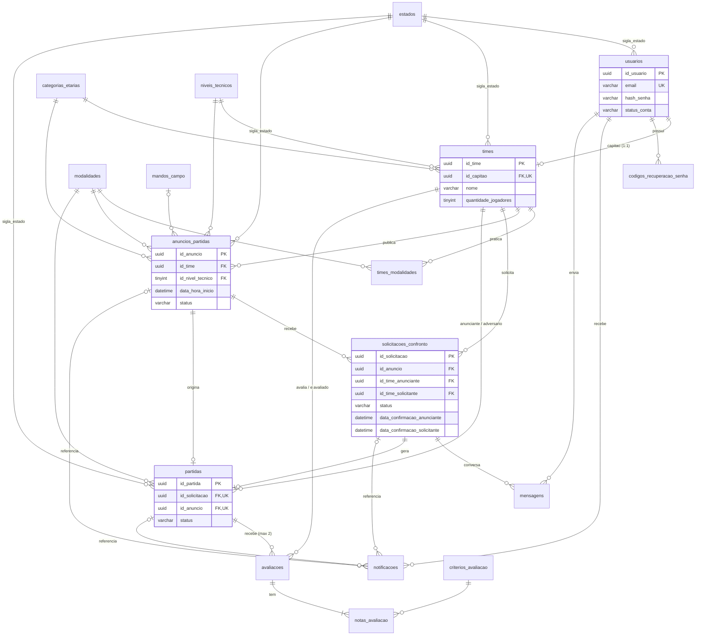

# Joga Contra — Banco de dados `joga_contra_v2` (MySQL 8.4 LTS)

Banco novo, em português, criado a partir de [docs/AUDITORIA_DADOS_DINAMICOS.md](../docs/AUDITORIA_DADOS_DINAMICOS.md). Ele **não substitui nem altera** o banco antigo `joga_contra` nem a pasta `database/`.

## Índice

1. [Arquivos e ordem de execução](#1-arquivos-e-ordem-de-execução)
2. [Decisões aplicadas](#2-decisões-aplicadas)
3. [Dicionário de dados](#3-dicionário-de-dados)
4. [Diagrama entidade-relacionamento](#4-diagrama-entidade-relacionamento)
5. [Chaves estrangeiras e cardinalidades](#5-chaves-estrangeiras-e-cardinalidades)
6. [Regras de integridade e responsabilidades](#6-regras-de-integridade-e-responsabilidades)
7. [Importação no MySQL Workbench](#7-importação-no-mysql-workbench)
8. [Consultas de validação e exemplos](#8-consultas-de-validação-e-exemplos)
9. [Relatório de compatibilidade com a API e o Flutter](#9-relatório-de-compatibilidade-com-a-api-e-o-flutter)
10. [Segurança](#10-segurança)
11. [Validação realizada](#11-validação-realizada)

---

## 1. Arquivos e ordem de execução

| Ordem | Arquivo | Conteúdo | Pode repetir? |
|---|---|---|---|
| 1 | [01_esquema.sql](01_esquema.sql) | Banco, 17 tabelas, PKs, 35 FKs, UNIQUEs, 65 CHECKs, índices | Não: falha se as tabelas já existirem (proteção contra sobrescrita) |
| 2 | [02_rotinas.sql](02_rotinas.sql) | 15 gatilhos e 7 procedimentos transacionais; evento opcional comentado | Não (falha se já existirem) |
| 3 | [03_dados_referencia.sql](03_dados_referencia.sql) | Estados, modalidades, categorias, níveis, mandos, critérios | **Sim** (idempotente) |
| 4 | [04_visoes.sql](04_visoes.sql) | 4 visões com os dados calculados para a API | Não (falha se já existirem) |
| 5 | [05_validacao.sql](05_validacao.sql) | Somente `SELECT`/`EXPLAIN`: confere a estrutura e traz consultas de exemplo | Sim |
| 6 | [06_testes_regras.sql](06_testes_regras.sql) | 59 testes automáticos das regras. **Somente em banco de teste** | Sim (limpa o que cria) |

Nenhum script contém `DROP DATABASE` ou `DROP TABLE`. O 06 remove apenas os registros e os procedimentos auxiliares `teste_*` que ele mesmo criou.

## 2. Decisões aplicadas

As regras obrigatórias do pedido foram aplicadas. Nos pontos que a auditoria deixou em aberto, usei os padrões propostos no prompt da etapa 2:

| Tema | Decisão |
|---|---|
| Capitão | Um time por capitão e um capitão por time (`un_times_capitao`) |
| Jogadores | Sem cadastro individual. Não há tabela de membros nem papéis de permissão |
| Quantidade de jogadores | Time: 5 a 60. Anúncio e partida: 5 a 30 **por equipe** |
| Nível técnico | **Obrigatório no anúncio** (regra 10). Opcional no time (o cadastro do app permite deixar em branco) |
| Anúncio indisponível | Status `encerrado` (partida confirmada). Os outros status são `ativo`, `pausado` e `expirado` |
| Partida cancelada | O anúncio continua encerrado; o capitão publica outro |
| Partida realizada | Rotina `proc_marcar_partidas_realizadas(3)`, a cada hora, 3 h após o início |
| Expiração de anúncio | Rotina `proc_expirar_anuncios()`, agendada pela API (há um evento MySQL opcional, comentado) |
| Placar | Opcional, só em partida `realizada`, registrado pela API |
| Vagas disponíveis | **Não incluído**: não existe no app nem no protótipo |
| Mando de campo, taxa, bairro, endereço | Mantidos e opcionais |
| Tabela `perfis` | **Não criada**: o perfil do capitão está em `usuarios` e o do time em `times`. Uma tabela separada duplicaria dados (relação 1:1) |
| Login com Google | Fora do escopo |
| Identificadores | UUID `CHAR(36)` em minúsculas, gerado pela API (e por `UUID()` nos procedimentos). As referências usam inteiros fixos |
| Datas | `DATETIME(3)` em UTC |
| Exclusão | Lógica (`data_exclusao` / `data_arquivamento`). FKs sem `CASCADE` (`RESTRICT`) |

Convenção de nomes: tudo em português, minúsculas e `snake_case`, sem acentos. Prefixos: `ce_` (chave estrangeira), `un_` (unicidade), `vr_` (verificação), `ind_` (índice), `gat_` (gatilho), `proc_` (procedimento), `vis_` (visão). A chave primária sempre se chama `PRIMARY` (imposição do MySQL). Os termos técnicos `hash`, `url` e `email` foram mantidos por não terem equivalente usual em português.

---

## 3. Dicionário de dados

Legenda: **PK** chave primária · **FK** chave estrangeira · **UN** único · **S** obrigatório · **N** opcional. `uuid` = `CHAR(36) ascii_bin`. `data` = `DATETIME(3)` em UTC.

### 3.1 Cadastros de referência

As tabelas `modalidades`, `categorias_etarias`, `niveis_tecnicos`, `mandos_campo` e `criterios_avaliacao` têm a mesma estrutura:

| Coluna | Tipo | Obr. | Descrição |
|---|---|---|---|
| `id_<entidade>` | TINYINT UNSIGNED | S | PK (`id_modalidade`, `id_categoria_etaria`, `id_nivel_tecnico`, `id_mando_campo`, `id_criterio`) |
| `codigo` | VARCHAR(30) ascii | S | UN. Código estável usado pelo app (`society`, `sub_19`...). Só `[a-z0-9_]` |
| `nome` | VARCHAR(60) | S | Texto exibido |
| `ordem` | SMALLINT UNSIGNED | S | Ordem de exibição |
| `ativo` | BOOLEAN | S | Itens inativos somem das listas, mas preservam o histórico |
| `data_criacao`, `data_atualizacao` | data | S | Auditoria |
| `idade_maxima` | TINYINT UNSIGNED | N | **Só em `categorias_etarias`**: 15, 17, 19 ou NULL (Livre) |

**`estados`**: `sigla` CHAR(2) PK (duas letras maiúsculas) · `nome` VARCHAR(40) UN · `ativo` BOOLEAN.

### 3.2 `usuarios`: capitães (os únicos com conta)

| Coluna | Tipo | Obr. | Descrição |
|---|---|---|---|
| `id_usuario` | uuid | S | PK |
| `nome` | VARCHAR(120) | S | Nome do capitão |
| `email` | VARCHAR(254) | S | UN, sem diferenciar maiúsculas. **Dado pessoal** |
| `hash_senha` | VARCHAR(255) ascii | S | Hash bcrypt/argon2 gerado pela API (mín. 50 caracteres). Nunca a senha |
| `telefone` | VARCHAR(20) | N | **Dado pessoal** |
| `url_foto` | VARCHAR(500) | N | Foto de perfil (upload ainda não existe) |
| `cidade` | VARCHAR(100) | N | |
| `sigla_estado` | CHAR(2) | N | FK `estados` |
| `status_conta` | VARCHAR(20) | S | `ativa` (padrão), `suspensa`, `excluida` |
| `data_verificacao_email` | data | N | |
| `data_criacao`, `data_atualizacao` | data | S | |
| `data_exclusao` | data | N | Preenchida se e somente se `status_conta = 'excluida'` |

### 3.3 `codigos_recuperacao_senha`

| Coluna | Tipo | Obr. | Descrição |
|---|---|---|---|
| `id_codigo` | uuid | S | PK |
| `id_usuario` | uuid | S | FK `usuarios` |
| `hash_codigo` | BINARY(32) | S | UN. SHA-256 do código enviado por e-mail |
| `data_expiracao` | data | S | Posterior à criação |
| `data_uso` | data | N | Uso único |
| `data_criacao` | data | S | |

### 3.4 `times`

| Coluna | Tipo | Obr. | Descrição |
|---|---|---|---|
| `id_time` | uuid | S | PK |
| `id_capitao` | uuid | S | FK `usuarios`, **UN** (exatamente um capitão; um time por capitão) |
| `nome` | VARCHAR(120) | S | |
| `sigla` | VARCHAR(4) | N | Texto do escudo. Se NULL, o app deriva do nome |
| `url_escudo` | VARCHAR(500) | N | |
| `cidade` | VARCHAR(100) | S | |
| `sigla_estado` | CHAR(2) | S | FK `estados` |
| `bairro` | VARCHAR(100) | N | |
| `quantidade_jogadores` | TINYINT UNSIGNED | S | Informada pelo capitão, de 5 a 60 |
| `id_categoria_etaria` | TINYINT UNSIGNED | S | FK |
| `id_nivel_tecnico` | TINYINT UNSIGNED | N | FK |
| `descricao` | VARCHAR(2000) | N | "Sobre o time" |
| `ano_fundacao` | SMALLINT UNSIGNED | N | De 1900 a 2100 |
| `telefone_contato` | VARCHAR(20) | N | Contato público do time (escolhido pelo capitão) |
| `verificado` | BOOLEAN | S | Padrão FALSE |
| `data_criacao`, `data_atualizacao` | data | S | |
| `data_arquivamento` | data | N | Time desativado (não pode ser reativado por atualização direta) |

### 3.5 `times_modalidades`

`id_time` (FK) + `id_modalidade` (FK) formam a PK composta. Também tem `data_criacao`. Guarda as modalidades praticadas pelo time.

### 3.6 `anuncios_partidas`

| Coluna | Tipo | Obr. | Descrição |
|---|---|---|---|
| `id_anuncio` | uuid | S | PK |
| `id_time` | uuid | S | FK `times`: anunciante, imutável |
| `id_modalidade` | TINYINT UNSIGNED | S | FK |
| `id_categoria_etaria` | TINYINT UNSIGNED | S | FK |
| `id_nivel_tecnico` | TINYINT UNSIGNED | **S** | FK (regra 10) |
| `id_mando_campo` | TINYINT UNSIGNED | N | FK |
| `quantidade_jogadores` | TINYINT UNSIGNED | S | Por equipe, de 5 a 30 |
| `data_hora_inicio` | data | S | Precisa ser futura ao criar ou remarcar |
| `cidade` | VARCHAR(100) | S | |
| `sigla_estado` | CHAR(2) | S | FK `estados` |
| `bairro` | VARCHAR(100) | N | |
| `nome_local` | VARCHAR(160) | S | Campo ou quadra |
| `endereco` | VARCHAR(255) | N | |
| `latitude`, `longitude` | DECIMAL(9,6) | N | Sempre em par e dentro dos limites |
| `valor_aluguel_por_time` | DECIMAL(10,2) | N | ≥ 0 |
| `descricao` | VARCHAR(1000) | N | "Observações" |
| `status` | VARCHAR(20) | S | `ativo`, `pausado`, `encerrado`, `expirado` |
| `data_criacao`, `data_atualizacao` | data | S | |
| `data_exclusao` | data | N | Exclusão lógica |

### 3.7 `solicitacoes_confronto`

| Coluna | Tipo | Obr. | Descrição |
|---|---|---|---|
| `id_solicitacao` | uuid | S | PK |
| `id_anuncio` | uuid | S | Parte da FK composta para o anúncio |
| `id_time_anunciante` | uuid | S | Preenchido pelo gatilho a partir do anúncio. FK composta (`id_anuncio`, `id_time_anunciante`) → `anuncios_partidas(id_anuncio, id_time)` |
| `id_time_solicitante` | uuid | S | FK `times`. Diferente do anunciante |
| `status` | VARCHAR(20) | S | `pendente`, `confirmada`, `recusada`, `cancelada`, `encerrada` |
| `mensagem_inicial` | VARCHAR(1000) | N | |
| `data_confirmacao_anunciante` | data | N | Concordância do time anunciante |
| `data_confirmacao_solicitante` | data | N | Concordância do time solicitante |
| `data_resposta` | data | N | Preenchida se e somente se não estiver pendente |
| `motivo_encerramento` | VARCHAR(255) | N | Obrigatório quando `encerrada` |
| `data_criacao` | data | S | Data da solicitação |
| `data_atualizacao` | data | S | |
| `chave_pendente` | CHAR(36), gerada | — | `id_time_solicitante` quando pendente. Garante uma pendente por time e anúncio |
| `chave_confirmada` | TINYINT, gerada | — | 1 quando confirmada. Garante **no máximo uma confirmada por anúncio** |

### 3.8 `mensagens`

| Coluna | Tipo | Obr. | Descrição |
|---|---|---|---|
| `id_mensagem` | uuid | S | PK |
| `id_solicitacao` | uuid | S | FK |
| `id_time_remetente` | uuid | S | FK `times`. Precisa ser um dos dois times da solicitação |
| `id_usuario_remetente` | uuid | S | FK `usuarios`. Precisa ser o capitão do time remetente |
| `texto` | VARCHAR(1000) | S | Não pode ser vazio. Imutável |
| `data_envio` | data | S | |
| `data_leitura` | data | N | Lida pelo outro capitão (pode ser registrada uma única vez) |

### 3.9 `partidas`

| Coluna | Tipo | Obr. | Descrição |
|---|---|---|---|
| `id_partida` | uuid | S | PK |
| `id_solicitacao` | uuid | S | UN. FK composta para a solicitação confirmada |
| `id_anuncio` | uuid | S | UN (uma partida por anúncio). FK |
| `id_time_anunciante`, `id_time_adversario` | uuid | S | FKs `times`. Diferentes entre si |
| `id_modalidade`, `quantidade_jogadores`, `data_hora_inicio`, `nome_local`, `endereco`, `cidade`, `sigla_estado`, `latitude`, `longitude`, `valor_aluguel_por_time` | conforme o anúncio | S/N | **Cópia** dos dados combinados. Imutável |
| `status` | VARCHAR(20) | S | `confirmada`, `realizada`, `cancelada` |
| `gols_anunciante`, `gols_adversario` | TINYINT UNSIGNED | N | Os dois juntos, só quando `realizada` |
| `id_time_cancelou` | uuid | N | FK `times`. Obrigatório quando cancelada (um dos dois times) |
| `motivo_cancelamento` | VARCHAR(500) | N | |
| `data_cancelamento` | data | N | Obrigatória quando cancelada |
| `data_realizacao` | data | N | Obrigatória quando realizada |
| `data_criacao` | data | S | Momento da confirmação |
| `data_atualizacao` | data | S | |

### 3.10 `avaliacoes` e `notas_avaliacao`

`avaliacoes`: `id_avaliacao` uuid PK · `id_partida` FK · `id_time_avaliador` FK · `id_time_avaliado` FK · `comentario` VARCHAR(1000) N · `data_criacao`. É **imutável** (por isso não tem `data_atualizacao`). Tem UN (`id_partida`, `id_time_avaliador`).

`notas_avaliacao`: `id_avaliacao` FK + `id_criterio` FK formam a PK. `nota` TINYINT de 1 a 5, imutável.

### 3.11 `notificacoes`

| Coluna | Tipo | Obr. | Descrição |
|---|---|---|---|
| `id_notificacao` | uuid | S | PK |
| `id_usuario_destinatario` | uuid | S | FK `usuarios` (capitão) |
| `tipo` | VARCHAR(40) | S | `solicitacao_recebida`, `mensagem_recebida`, `partida_confirmada`, `partida_cancelada`, `solicitacao_encerrada`, `solicitacao_recusada`, `anuncio_expirando`, `avaliacao_pendente` |
| `titulo` | VARCHAR(160) | S | |
| `mensagem` | VARCHAR(500) | S | |
| `id_anuncio` / `id_solicitacao` / `id_partida` | uuid | N | FKs. No máximo uma preenchida (destino ao tocar) |
| `data_leitura` | data | N | Só a leitura pode ser registrada, uma vez |
| `data_criacao` | data | S | |

### 3.12 Visões (dados calculados, nada armazenado)

| Visão | Colunas principais | Uso no app |
|---|---|---|
| `vis_estatisticas_times` | `id_time`, `total_partidas_realizadas`, `media_avaliacao` (1 casa), `total_avaliacoes` | Estatísticas do Início e do Perfil |
| `vis_perfis_times` | Time + nomes de categoria/nível + `nome_capitao` + estatísticas. **Sem e-mail ou telefone pessoal** | `GET /times/:id` |
| `vis_anuncios_disponiveis` | Anúncio ativo, futuro e não excluído + time + nomes das referências + `total_solicitacoes` | Busca, Início, Mapa |
| `vis_resumo_solicitacoes` | `ultima_mensagem`, `data_ultima_mensagem`, `nao_lidas_anunciante`, `nao_lidas_solicitante` | Lista de conversas |

---

## 4. Diagrama entidade-relacionamento



O diagrama é renderizado pelo GitHub e pelo VS Code (extensão Mermaid). No Workbench, use **Database › Reverse Engineer** sobre `joga_contra_v2` para gerar o EER.

---

## 5. Chaves estrangeiras e cardinalidades

Todas as FKs usam `ON DELETE RESTRICT` e `ON UPDATE RESTRICT`, o padrão do MySQL: nenhum histórico é apagado em cascata.

| Tabela (filha) | Restrição | Colunas | Referência | Cardinalidade |
|---|---|---|---|---|
| usuarios | `ce_usuarios_estados` | sigla_estado | estados | N:0..1 |
| codigos_recuperacao_senha | `ce_codigos_recuperacao_senha_usuarios` | id_usuario | usuarios | N:1 |
| times | `ce_times_usuarios` | id_capitao (UN) | usuarios | **1:1** |
| times | `ce_times_estados` | sigla_estado | estados | N:1 |
| times | `ce_times_categorias_etarias` | id_categoria_etaria | categorias_etarias | N:1 |
| times | `ce_times_niveis_tecnicos` | id_nivel_tecnico | niveis_tecnicos | N:0..1 |
| times_modalidades | `ce_times_modalidades_times` / `_modalidades` | id_time / id_modalidade | times / modalidades | **N:N** |
| anuncios_partidas | `ce_anuncios_partidas_times` | id_time | times | 1 time : N anúncios |
| anuncios_partidas | `ce_anuncios_partidas_modalidades` / `_categorias_etarias` / `_niveis_tecnicos` | ... | referências | N:1 |
| anuncios_partidas | `ce_anuncios_partidas_mandos_campo` | id_mando_campo | mandos_campo | N:0..1 |
| anuncios_partidas | `ce_anuncios_partidas_estados` | sigla_estado | estados | N:1 |
| solicitacoes_confronto | `ce_solicitacoes_confronto_anuncios_partidas` | (id_anuncio, id_time_anunciante) | anuncios_partidas (id_anuncio, id_time) | 1 anúncio : N solicitações |
| solicitacoes_confronto | `ce_solicitacoes_confronto_times` | id_time_solicitante | times | 1 time : N solicitações |
| mensagens | `ce_mensagens_solicitacoes_confronto` | id_solicitacao | solicitacoes_confronto | 1:N |
| mensagens | `ce_mensagens_times` / `ce_mensagens_usuarios` | id_time_remetente / id_usuario_remetente | times / usuarios | N:1 |
| partidas | `ce_partidas_solicitacoes_confronto` | (id_solicitacao, id_anuncio, id_time_anunciante, id_time_adversario) | solicitacoes_confronto (id_solicitacao, id_anuncio, id_time_anunciante, id_time_solicitante) | **1:0..1** (UN id_solicitacao) |
| partidas | `ce_partidas_anuncios_partidas` | id_anuncio (UN) | anuncios_partidas | **1:0..1** |
| partidas | `ce_partidas_time_anunciante` / `_time_adversario` / `_time_cancelou` | ... | times | N:1 / N:0..1 |
| partidas | `ce_partidas_modalidades` / `ce_partidas_estados` | ... | referências | N:1 |
| avaliacoes | `ce_avaliacoes_partidas` | id_partida | partidas | 1 partida : 0..2 avaliações |
| avaliacoes | `ce_avaliacoes_time_avaliador` / `_time_avaliado` | ... | times | N:1 |
| notas_avaliacao | `ce_notas_avaliacao_avaliacoes` / `_criterios_avaliacao` | ... | avaliacoes / criterios_avaliacao | 1 avaliação : N notas |
| notificacoes | `ce_notificacoes_usuarios` | id_usuario_destinatario | usuarios | 1:N |
| notificacoes | `ce_notificacoes_anuncios_partidas` / `_solicitacoes_confronto` / `_partidas` | ... | ... | N:0..1 (no máximo uma) |

Por que as FKs compostas: elas garantem pelo próprio banco que a solicitação aponta para o time realmente dono do anúncio, e que a partida usa exatamente os mesmos anúncio e times da solicitação confirmada. As FKs diretas de `partidas` para `times` e `anuncios_partidas` repetem essa garantia de propósito, para deixar as relações explícitas em ferramentas como o EER do Workbench e para o otimizador.

---

## 6. Regras de integridade e responsabilidades

### 6.1 Regras de negócio obrigatórias

| # | Regra | Como é garantida | Camada |
|---|---|---|---|
| 1 | Cada time tem exatamente um capitão | `times.id_capitao NOT NULL` + `un_times_capitao` + gatilho exige conta ativa | Banco |
| 2 | Jogadores sem cadastro individual | Não existe tabela de membros | Modelo |
| 3 | Quantidade de jogadores informada pelo capitão | `times.quantidade_jogadores NOT NULL`, de 5 a 60 | Banco + API (formulário) |
| 4 | Um time publica vários anúncios | `anuncios_partidas.id_time` (1:N); gatilho exige time e capitão ativos | Banco |
| 5 | Um anúncio recebe solicitações de vários times | 1:N; uma pendente por time (`un_solicitacoes_confronto_pendente`); sem autossolicitação (CHECK + gatilho) | Banco |
| 6 | Confirmação exige as duas equipes | Duas datas de confirmação; `vr_solicitacoes_confronto_confirmada` impede `confirmada` sem as duas; confirmação não pode ser desfeita (gatilho) | Banco + `proc_confirmar_solicitacao` |
| 7 | Após a confirmação, o anúncio fica indisponível | O procedimento muda o status para `encerrado`. O gatilho só aceita `encerrado` com partida existente e impede reabrir, editar ou excluir. A visão de busca só mostra `ativo` | Procedimento + gatilho |
| 8 | As demais solicitações são encerradas automaticamente | Na mesma transação da confirmação | `proc_confirmar_solicitacao` |
| 9 | Capitães não selecionados são notificados | Uma notificação `solicitacao_encerrada` por capitão afetado, na mesma transação | `proc_confirmar_solicitacao` |
| 10 | Anúncio tem modalidade, categoria e nível | As três FKs `NOT NULL` | Banco |

### 6.2 Confirmação: transação e concorrência

`CALL proc_confirmar_solicitacao(id_solicitacao, id_usuario)`:

1. `START TRANSACTION`.
2. Bloqueia **o anúncio** (`SELECT ... FOR UPDATE`). Toda confirmação do mesmo anúncio passa por esse bloqueio, então elas acontecem uma de cada vez.
3. Bloqueia e relê a solicitação; valida se está pendente, se o anúncio está ativo, não excluído e com data futura, e se o usuário é capitão de um dos dois times.
4. Registra a data de confirmação do lado do usuário. Repetir a chamada não altera a data.
5. Se os dois lados confirmaram: a solicitação vira `confirmada`, a **partida** é criada com cópia dos dados, o anúncio vira `encerrado`, os capitães afetados são **notificados**, as demais pendentes são **encerradas** e os dois envolvidos recebem `partida_confirmada`.
6. `COMMIT`. Em qualquer erro: `ROLLBACK` e o erro é repassado à API (`RESIGNAL`).

Barreiras extras que funcionam **mesmo que alguém altere as tabelas sem usar o procedimento**:
- `un_solicitacoes_confronto_confirmada`: no máximo uma solicitação confirmada por anúncio.
- `un_partidas_anuncio` e `un_partidas_solicitacao`: no máximo uma partida.
- O gatilho de inserção de solicitação lê o anúncio com `FOR SHARE`. Se uma confirmação estiver em andamento, ele espera e enxerga o status já `encerrado`, o que impede uma solicitação "fantasma" num anúncio recém-fechado.

Teste realizado: em 20 rodadas, duas sessões paralelas tentaram confirmar duas solicitações diferentes do mesmo anúncio. Em **todas**, exatamente uma venceu, uma partida foi criada, a outra solicitação foi encerrada e notificada, e a sessão perdedora recebeu `Esta solicitação não está mais em aberto.`

### 6.3 Quem faz o quê

| Responsabilidade | Banco | API |
|---|---|---|
| Tipos, obrigatoriedade, domínios (CHECK), unicidade, FKs | ✔ | Valida antes também (mensagens amigáveis via zod) |
| Transições de status (anúncio, solicitação, partida) | ✔ gatilhos | Chama os procedimentos |
| Confirmação, recusa, desistência, cancelamento de partida, exclusão de anúncio | ✔ procedimentos `proc_*` (atômicos) | Autentica, passa o `id_usuario` da sessão e chama `CALL` **fora de transação aberta** |
| Cadastro capitão + time + modalidades | Restrições e gatilhos | **Transação da API**: `INSERT usuarios`, `INSERT times`, `INSERT times_modalidades` |
| Hash de senha e de código de recuperação | Só armazena | Gera (bcrypt custo ≥ 12; SHA-256 do código) |
| Autorização de leitura (quem vê o quê) | Visões sem dados pessoais | Filtra pelo time do usuário logado |
| Criar `solicitacao_recebida`, `mensagem_recebida`, `anuncio_expirando` | Tabela e CHECK de tipo | Insere junto da ação, na mesma transação |
| Rotinas temporais (expirar, marcar realizadas) | `proc_expirar_anuncios`, `proc_marcar_partidas_realizadas` | Agenda (cron/job) ou ativa o `EVENT` comentado |
| Distância, paginação, busca por texto | Índices | Calcula e filtra |
| Registro de placar | CHECK (só em realizada) | Define quem pode informar |

Todos os erros de regra usam `SQLSTATE 45000` (errno 1644) com mensagem em português. O `error-handler.ts` atual já converte isso em HTTP 409.

---

## 7. Importação no MySQL Workbench

1. **Faça backup** antes de qualquer coisa: *Server › Data Export* do banco `joga_contra` existente (ou `mysqldump`). Os scripts não tocam nele, mas é a prática segura.
2. Conecte-se ao servidor MySQL 8.4 com um usuário administrador (precisa de `CREATE`, `CREATE ROUTINE`, `TRIGGER`, `CREATE VIEW`).
3. Confirme que `joga_contra_v2` ainda **não existe**: `SHOW DATABASES LIKE 'joga_contra_v2';`.
4. Abra *File › Open SQL Script…* e escolha `01_esquema.sql`. Execute com o raio (⚡ *Execute the selected portion or everything*). Confira em *Output* que não houve erro.
5. Repita com `02_rotinas.sql`. O Workbench entende `DELIMITER $$`. Se o servidor tiver log binário ativo e aparecer o erro 1419, um administrador precisa executar `SET GLOBAL log_bin_trust_function_creators = 1;`.
6. Execute `03_dados_referencia.sql` e depois `04_visoes.sql`.
7. Execute `05_validacao.sql` e confira: **17 tabelas, 4 visões, 15 gatilhos, 7 procedimentos**, dados de referência **27/2/4/3/3/4** e nenhuma linha em "tabela_faltando" e "fora_do_padrao".
8. (Opcional, só em ambiente de teste) Execute `06_testes_regras.sql`. O resultado final deve ser **59 aprovados / 0 reprovados**.
9. Para o diagrama EER: *Database › Reverse Engineer…* e selecione `joga_contra_v2`.

Pela linha de comando (PowerShell), na pasta `database_v2`:

```powershell
$mysql = "C:\Program Files\MySQL\MySQL Server 8.4\bin\mysql.exe"
Get-Content 01_esquema.sql, 02_rotinas.sql, 03_dados_referencia.sql, 04_visoes.sql -Encoding UTF8 -Raw |
  & $mysql -u SEU_USUARIO_ADMIN -p --default-character-set=utf8mb4
```

Configuração da API (`backend/.env`, quando ela for adaptada): `DB_NAME=joga_contra_v2` e a conexão com `timezone: 'Z'` executando `SET time_zone = '+00:00'`, como o `config/db.ts` atual já faz.

---

## 8. Consultas de validação e exemplos

[05_validacao.sql](05_validacao.sql) contém:

- **Parte A** (estrutura): versão, contagem de objetos, tabelas faltando, dados de referência, listagem de FKs, gatilhos, procedimentos e conferência da convenção de nomes.
- **Parte B** (funcionalidades): `GET /referencias`, login, perfil do time, busca de anúncios com filtros, meus anúncios, conversas com não lidas, mensagens, próxima partida, minhas partidas com "avaliada pelo meu time", avaliações recebidas, notificações e `EXPLAIN` das consultas mais frequentes.

Exemplos das operações de escrita principais:

```sql
-- Tenho interesse
INSERT INTO solicitacoes_confronto (id_solicitacao, id_anuncio, id_time_solicitante, mensagem_inicial)
VALUES (?, ?, ?, ?);            -- id_time_anunciante é preenchido pelo gatilho

-- Confirmar partida (cada capitão chama uma vez)
CALL proc_confirmar_solicitacao(?, ?);   -- retorna id_partida quando os dois confirmaram

-- Recusar / desistir / cancelar partida / excluir anúncio
CALL proc_recusar_solicitacao(?, ?);
CALL proc_cancelar_solicitacao(?, ?);
CALL proc_cancelar_partida(?, ?, 'motivo');
CALL proc_excluir_anuncio(?, ?);

-- Pausar / reativar anúncio
UPDATE anuncios_partidas SET status = 'pausado' WHERE id_anuncio = ? AND id_time = ?;

-- Rotinas agendadas (a cada hora)
CALL proc_expirar_anuncios();
CALL proc_marcar_partidas_realizadas(3);
```

---

## 9. Relatório de compatibilidade com a API e o Flutter

### 9.1 Mapeamento coluna → JSON (contrato já usado por `lib/models/`)

A API converte `snake_case` para camelCase e aninha as referências como `{id, codigo, nome, ordem}`.

| Modelo Flutter | Campo JSON | Origem no banco |
|---|---|---|
| `ItemReferencia` | `id`, `codigo`, `nome`, `ordem` | `id_*`, `codigo`, `nome`, `ordem` das tabelas de referência |
| `Estado` | `sigla`, `nome` | `estados` |
| `Usuario` | `idUsuario`, `nome`, `email`, `telefone`, `urlFoto`, `cidade`, `siglaEstado` | `usuarios` (só para o próprio usuário) |
| `Time` | `idTime`, `idCapitao`, `nome`, `sigla`, `urlEscudo`, `cidade`, `siglaEstado`, `bairro`, `quantidadeJogadores`, `descricao`, `anoFundacao`, `telefoneContato`, `verificado` | `times` |
| `Time` | `categoriaEtaria`, `nivelTecnico` | joins de referência (`vis_perfis_times`) |
| `Time` | `modalidades[]` | `times_modalidades` + `modalidades` |
| `Time` | `nomeCapitao`, `totalPartidasRealizadas`, `mediaAvaliacao`, `totalAvaliacoes` | `vis_perfis_times` / `vis_estatisticas_times` |
| `ResumoTime` | `idTime`, `nome`, `sigla`, `urlEscudo`, `cidade`, `siglaEstado`, `nomeCapitao` | `times` + `usuarios.nome` |
| `AnuncioPartida` | `idAnuncio`, `quantidadeJogadores`, `dataHoraInicio` (ISO UTC com `Z`), `cidade`, `siglaEstado`, `bairro`, `nomeLocal`, `endereco`, `valorAluguelPorTime` (número), `descricao`, `status` | `anuncios_partidas` |
| `AnuncioPartida` | `time`, `modalidade`, `categoriaEtaria`, `nivelTecnico`, `mandoCampo`, `totalSolicitacoes` | `vis_anuncios_disponiveis` (ou os mesmos joins para "meus anúncios") |
| `AnuncioPartida` | `distanciaKm` | **Calculado pela API** com `latitude`/`longitude` (Haversine ou `ST_Distance_Sphere`) |
| `SolicitacaoConfronto` | `idSolicitacao`, `status`, `mensagemInicial`, `dataSolicitacao` (= `data_criacao`), `dataResposta` | `solicitacoes_confronto` |
| `SolicitacaoConfronto` | `confirmadoAnunciante`, `confirmadoSolicitante` | `data_confirmacao_* IS NOT NULL` |
| `SolicitacaoConfronto` | `idPartida` | `partidas.id_partida` por `id_solicitacao` |
| `SolicitacaoConfronto` | `ultimaMensagem`, `dataUltimaMensagem`, `mensagensNaoLidas` | `vis_resumo_solicitacoes` (`nao_lidas_*` do lado do usuário) |
| `Mensagem` | `idMensagem`, `idSolicitacao`, `idTimeRemetente`, `texto`, `dataEnvio` | `mensagens` |
| `Partida` | `idPartida`, `idAnuncio`, `idSolicitacao`, `dataHoraInicio`, `nomeLocal`, `endereco`, `cidade`, `siglaEstado`, `status`, `golsAnunciante`, `golsAdversario` | `partidas` |
| `Partida` | `timeAnunciante`, `timeAdversario`, `modalidade` | joins |
| `Partida` | `avaliadaPeloMeuTime` | `EXISTS` em `avaliacoes` (consulta B10) |
| `NovaAvaliacao` | `notas[{idCriterio, nota}]`, `comentario` | `avaliacoes` + `notas_avaliacao` (inserir na mesma transação) |
| `AvaliacaoRecebida` | `notaMedia`, `comentario`, `timeAvaliador`, `dataAvaliacao` | consulta B11 |
| `Notificacao` | `idNotificacao`, `tipo`, `titulo`, `mensagem`, `idAnuncio`, `idSolicitacao`, `idPartida`, `dataCriacao` | `notificacoes` |
| `Notificacao` | `lida` | `data_leitura IS NOT NULL` |

Os códigos de status e de tipo de notificação no banco são **idênticos** aos enums do Flutter (`StatusAnuncio`, `StatusSolicitacao`, `StatusPartida`, `TipoNotificacao`), e os ids das referências batem com os dados de demonstração do app.

### 9.2 Divergências e ajustes pendentes

**Flutter.** Pequenos ajustes, não feitos porque nesta etapa o app não deve ser alterado:

| Item | Hoje no app | Banco | Ajuste |
|---|---|---|---|
| Jogadores por equipe no anúncio | Validação 2–30 (`activity_screens.dart`) | 5–30 | Mudar a validação para 5–30 |
| Jogadores do time no cadastro | Validação 1–60 (`account_screens.dart`) | 5–60 | Mudar a validação para 5–60 |
| Nível técnico do anúncio | `RascunhoAnuncio.idNivelTecnico` é `int?` | Obrigatório | O formulário já exige; tornar o tipo `int` não-nulo |
| Distância | `FiltroAnuncios.raioKm` sem a posição do usuário | Coordenadas opcionais no anúncio | Enviar `latitude`/`longitude` do aparelho quando houver geolocalização |
| Cancelar partida com motivo | Não pede motivo | `motivo_cancelamento` opcional | Opcional: campo de motivo no diálogo |

**API Express (próxima etapa).** Incompatível com este banco hoje:

1. Todas as consultas usam o schema antigo (`users`, `teams`, `game_listings`, `game_interests`, `team_members`...).
2. Remover `team_members`, os papéis e `requireActiveMembership`. A autorização passa a ser "o usuário logado é o `id_capitao` do time".
3. `/auth/cadastro`: transação com `usuarios` + `times` + `times_modalidades`.
4. Confirmar, recusar, cancelar e excluir via `CALL proc_*` em vez de `UPDATE` direto.
5. Novas rotas: `/referencias`, `/solicitacoes/*`, `/partidas/*`, `/notificacoes/*`, `/times/:id/avaliacoes`, mensagens e recuperação de senha (contrato na seção 8 da auditoria).
6. Agendar as duas rotinas temporais.
7. `seed-reference.ts` e `verify-schema.ts` apontam para o schema antigo; substituir por `03_dados_referencia.sql` e `05_validacao.sql`.

---

## 10. Segurança

- Senhas e códigos de recuperação só como hash (`hash_senha` com no mínimo 50 caracteres por CHECK; `hash_codigo BINARY(32)`). Os scripts não contêm credenciais.
- Dados pessoais (`usuarios.email`, `usuarios.telefone`) não aparecem nas visões públicas. Use `vis_perfis_times` para perfis de outros times.
- Não há `ON DELETE CASCADE`. A exclusão é lógica, e as FKs impedem apagar registros com histórico. Para pedidos de exclusão (LGPD): `status_conta = 'excluida'`, `data_exclusao = agora` e anonimização de nome, e-mail (por exemplo `excluido+<id>@invalid`) e telefone pela API.
- **Usuário de aplicação com privilégio mínimo** (execute como administrador, trocando a senha):

```sql
CREATE USER 'joga_contra_api'@'%' IDENTIFIED BY 'TROQUE_POR_UMA_SENHA_FORTE';
GRANT SELECT ON joga_contra_v2.* TO 'joga_contra_api'@'%';
GRANT INSERT, UPDATE ON joga_contra_v2.usuarios TO 'joga_contra_api'@'%';
GRANT INSERT, UPDATE ON joga_contra_v2.codigos_recuperacao_senha TO 'joga_contra_api'@'%';
GRANT INSERT, UPDATE ON joga_contra_v2.times TO 'joga_contra_api'@'%';
GRANT INSERT, DELETE ON joga_contra_v2.times_modalidades TO 'joga_contra_api'@'%';
GRANT INSERT, UPDATE ON joga_contra_v2.anuncios_partidas TO 'joga_contra_api'@'%';
GRANT INSERT ON joga_contra_v2.solicitacoes_confronto TO 'joga_contra_api'@'%';
GRANT INSERT, UPDATE ON joga_contra_v2.mensagens TO 'joga_contra_api'@'%';
GRANT UPDATE ON joga_contra_v2.partidas TO 'joga_contra_api'@'%';      -- placar
GRANT INSERT ON joga_contra_v2.avaliacoes TO 'joga_contra_api'@'%';
GRANT INSERT ON joga_contra_v2.notas_avaliacao TO 'joga_contra_api'@'%';
GRANT INSERT, UPDATE ON joga_contra_v2.notificacoes TO 'joga_contra_api'@'%';
GRANT EXECUTE ON joga_contra_v2.* TO 'joga_contra_api'@'%';
```

O usuário da API **não tem `UPDATE` em `solicitacoes_confronto`**. Confirmar, recusar e cancelar só são possíveis pelos procedimentos (que rodam com os privilégios do definidor), o que fecha o atalho de alterar status direto pela API. Ele também não tem `DELETE` nas tabelas de histórico nem privilégios de DDL. Em produção, troque `'%'` pelo host da API e exija TLS (`REQUIRE SSL`).

---

## 11. Validação realizada

Todos os scripts foram executados numa **instância MySQL 8.4.13 temporária e isolada**: pasta de dados própria, porta 3399, sem ler o `my.ini` do serviço, descartada ao final. O serviço `MySQL84` e o banco `joga_contra` não foram tocados.

| Verificação | Resultado |
|---|---|
| 01 a 04 num servidor vazio | Sem erros |
| Reexecutar 01 com o banco já criado | Falha na 1ª tabela (`ERROR 1050`), sem apagar nada |
| 03 executado três vezes | Sem duplicar registros (27 UFs, 2, 4, 3, 3, 4) |
| 05 (estrutura) | 17 tabelas, 4 visões, 15 gatilhos, 7 procedimentos, 35 FKs, 65 CHECKs; nenhum nome fora do padrão |
| 06 (regras) | **59 aprovados, 0 reprovados**; limpeza deixou 0 linhas |
| Concorrência (2 sessões, mesmo anúncio) | **20/20 rodadas corretas** |
| Índices (`EXPLAIN` com 3.000 anúncios) | Busca por UF/cidade usa `ind_anuncios_partidas_busca_local` (`range`); notificações usam `ind_notificacoes_destinatario` (`ref`) |
| Bloqueio de linhas no procedimento | `FOR UPDATE` bloqueia 1 linha (medido em `performance_schema.data_locks`) |

| Privilégio mínimo (seção 10) | GRANTs aplicados: a API é **negada** em `UPDATE` de `solicitacoes_confronto`, `DELETE` de `partidas` e `DROP`, e **consegue** confirmar a partida via `proc_confirmar_solicitacao` |

Observações para a API (colunas de identificador e status são `ascii_bin`):
- Variáveis de sessão (`SET @x = '...'`) são `utf8mb4` e, comparadas a colunas `ascii_bin`, impedem o uso de índice. Literais e parâmetros preparados (como os do `mysql2.execute`) usam o índice normalmente. O script 05 já declara suas variáveis em `ascii`.
- Não concatene no SQL texto com acento junto de colunas `ascii` (ex.: `CONCAT('anúncio: ', status)` gera `ERROR 1267`). Monte esses textos na API.
